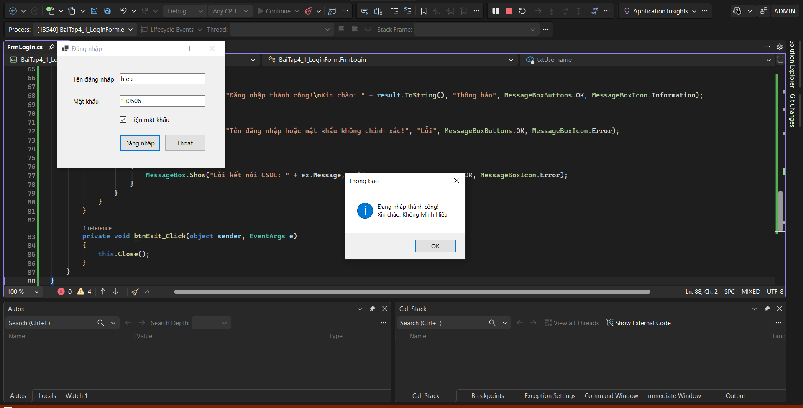
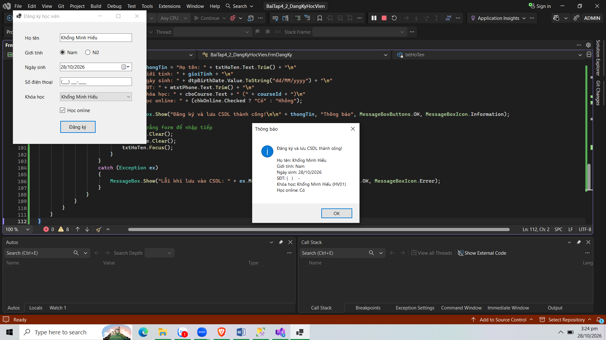

# BÁO CÁO BÀI TẬP THỰC HÀNH LẬP TRÌNH C# WINFORMS
## I. THÔNG TIN SINH VIÊN
* **Họ và tên:** Khổng Minh Hiếu
* **Mã số sinh viên:** 24810320250
* **Lớp học phần:** Lập trình .NET - Mã Lớp: D19QTANM1
* **Link Repository:** https://github.com/khongminhhieu1805/LTNET_24810320250_KhongMinhHieu

---
## II. DANH SÁCH BÀI TẬP HOÀN THÀNH & TỰ ĐÁNH GIÁ
| Bài tập | Tiêu đề bài tập | Trạng thái | Mức độ hoàn thành (%) |
| :---: | :--- | :---: | :---: |
| **Bài 4.1** | Form Đăng nhập & Xác thực CSDL SQL Server | Hoàn thành | 100% |
| **Bài 4.2** | Đăng ký Học viên & Lưu trữ CSDL SQL Server | Hoàn thành | 100% |

---
## III. MINH HỌA GIAO DIỆN & KỸ THUẬT NỔI BẬT
### 1. Bài 4.1: Form Đăng nhập & Xác thực CSDL SQL Server
* **Kỹ thuật áp dụng:** Thư viện `System.Data.SqlClient`, bảo mật mật khẩu với `txtPassword.UseSystemPasswordChar`, bắt lỗi để trống bằng `ErrorProvider`, truy vấn dữ liệu an toàn tránh SQL Injection bằng `SqlCommand` có `@Parameters`, xác thực tài khoản qua `ExecuteScalar()`.
* **Hình ảnh minh họa Giao diện:**

*Mô tả: Giao diện đăng nhập kết nối trực tiếp đến CSDL SQL Server (QuanLyDaoTao).*
.png).
*Mô tả : Khi nhập sai tên và mật khẩu*
---
### 2. Bài 4.2: Quản lý Đăng ký Học viên
* **Kỹ thuật áp dụng:** Nạp dữ liệu từ bảng `Courses` vào `ComboBox` khi tải form (`SqlDataAdapter` & `DataTable`), xử lý sự kiện đăng ký lưu dữ liệu vào bảng `Students` bằng lệnh `INSERT INTO` qua `SqlCommand` và `ExecuteNonQuery()`.
* **Hình ảnh minh họa Giao diện:**

*Mô tả: Giao diện Đăng ký khóa học và lưu trữ thông tin học viên vào CSDL.*

---
## IV. HƯỚNG DẪN CÀI ĐẶT & CHẠY DỰ ÁN
1. Clone Repository về máy:
```bash
git clone https://github.com/khongminhhieu1805/LTNET_24810320250_KhongMinhHieu